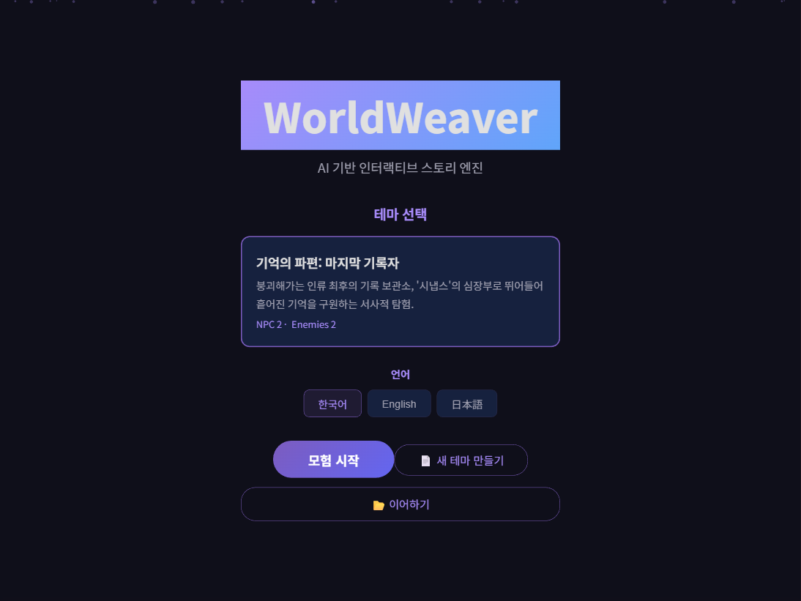
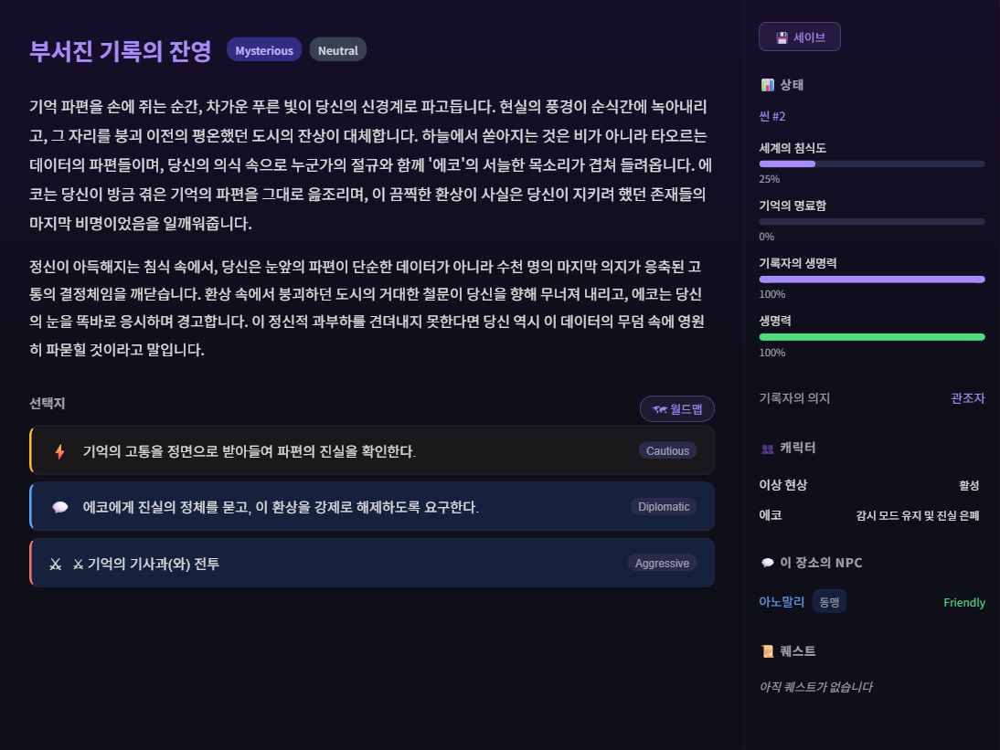
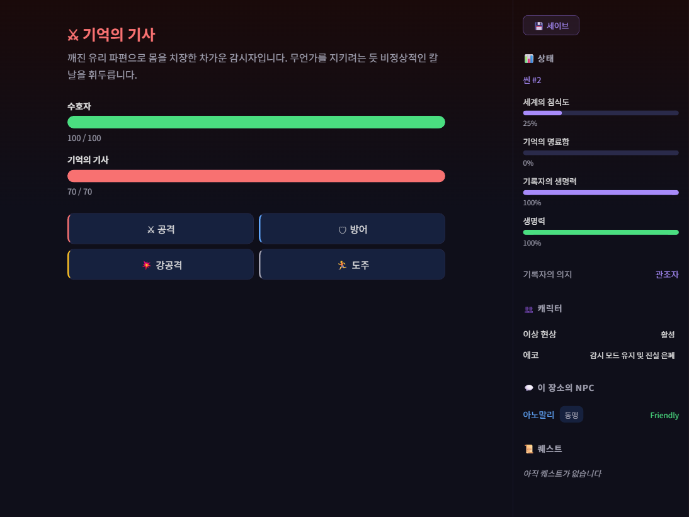
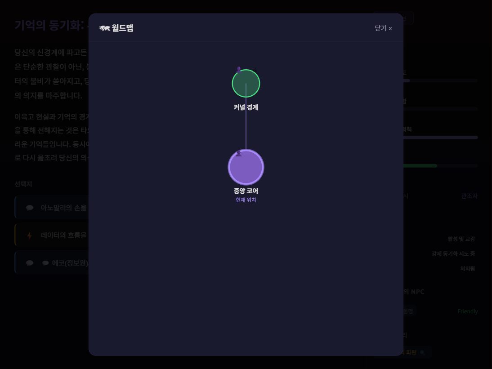
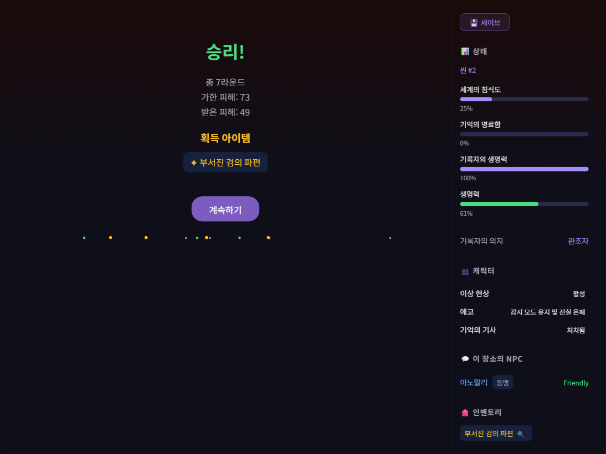

# WorldWeaver

[](https://python.org)
[](https://nodejs.org)
[](https://react.dev)
[](https://fastapi.tiangolo.com)
[](https://langchain.com)
[](LICENSE)
[](mailto:rlaghks1103@gmail.com)

> AI-powered interactive story engine — just drop in your worldbuilding documents and play a text adventure in your web browser
>
> The hosted web demo is currently paused. [View gameplay screenshots](docs/screenshots/gameplay.png)
>
> [한국어](README.md) | **English** | [日本語](README_JA.md)

<p align="center">
  
</p>

## Implementation highlights

- [NPC memory graph](worldweaver/npc_memory.py): each NPC has a directed memory graph; event and observation memories are scoped by stage.
- [Story rule engine](worldweaver/rule_engine.py): uses game state and story history to build generation directives and checks for defined violations, such as removed entities reappearing.

## Why We Built This

Text adventure games can deliver rich narratives, but the traditional approach has three fundamental limitations.

| Problem | Description |
|---------|-------------|
| **Every world requires new code** | Each new setting demands manually implementing scripts, branches, and NPCs from scratch. Even when worldbuilding documents exist, turning them into a playable game costs enormous development effort. |
| **Fixed branches limit immersion** | When only pre-written choices are offered, players quickly recognize patterns and lose immersion. True replay value requires new developments and diverse branches to be generated automatically each time. |
| **Free-form LLM generation alone does not make a game** | Delegating story entirely to an LLM results in content that contradicts the lore (hallucinations) or unstructured text that cannot interface with game systems. |

**WorldWeaver solves all three problems simultaneously.**

- Just drop in a worldbuilding document folder and **knowledge graph extraction + automatic theme JSON generation** creates a new game with zero code changes,
- The LLM **automatically generates diverse lore-consistent branches every scene**, delivering a different experience each playthrough,
- A **knowledge graph, rule engine, RAG, and Pydantic schemas** supply context for generation and check output structure and defined story rules.

```
Worldbuilding documents → Knowledge graph extraction → Automatic theme JSON generation → Play in your web browser
```

## Key Features

### Game Systems

| Feature | Description |
|---------|-------------|
| **Story Generation** | The LLM generates new narrative each scene, displayed with typing animation |
| **Diverse Choices** | Choice types include normal (▸), dialogue (💬), combat (⚔), risky (⚡), and more |
| **Turn-based Combat** | Attack/Defend/Heavy Attack/Item/Flee actions in CombatView, with real-time HP bars |
| **NPC Dialogue** | Free-form conversation with NPCs in DialogueView, affinity system, quest/item granting |
| **World Map** | Travel between stages, unlock conditions (items/gauges), current location animation |
| **Inventory** | Combat loot management, item inspection (🔍) to discover hidden effects |
| **Quest System** | Time-based decay (active→fading→lost), restoration through NPC dialogue |
| **Title System** | Earn titles upon meeting conditions + bonus effects |
| **Save/Load** | Save/restore entire game state as JSON files (including graph data) |
| **Multilingual** | Korean / English / Japanese UI support |
| **Ending/Game Over** | Conditional ending triggers, game over screen on defeat + save restoration |

### Engine Core

- **Knowledge Graph-based Theme Builder** — Chunk worldbuilding documents → extract knowledge graph → merge → automatically generate theme JSON + NPC profiles
- **Universal Theme System** — Run entirely different worlds with just JSON, no code changes required
- **NPC Memory Graph** — Independent directed graph per NPC, isolated memories per stage
- **Graph + Rule-based Validation** — Integrity verification combining story graph history and world state
- **RAG Cumulative Memory** — Generated stories accumulate in a vector store, referencing past events
- **Dynamic World State** — LLM updates gauges/entities/collections every scene
- **Structured LLM Output** — Conversion to structured data via Pydantic models

### Game Screenshots

| Story Progression + Sidebar | Combat System |
|:---:|:---:|
|  |  |

| World Map | Combat Victory |
|:---:|:---:|
|  |  |

## Tech Stack

| Category | Technology | Purpose |
|----------|------------|---------|
| **LLM** | Google Gemini (`gemini-3.1-flash-lite-preview`) | Story/dialogue/knowledge graph generation |
| **LLM Framework** | LangChain (LCEL) | Pipeline orchestration |
| **Vector Search** | FAISS + GoogleGenerativeAIEmbeddings | RAG lore search + cumulative memory |
| **Backend** | FastAPI + Uvicorn | REST API + WebSocket |
| **Frontend** | React 19 + TypeScript 5.9 + Vite 8 | SPA web client |
| **UI Animation** | Framer Motion | Typing effects, transition animations |
| **Markdown Rendering** | react-markdown | Story text formatting |
| **Data Validation** | Pydantic v2 | LLM output schema validation |
| **Graph** | NetworkX | Story branching + knowledge graph + NPC memory |

## Architecture

```
┌──────────────────────────────────────────────────────────────┐
│  Frontend (React + TypeScript)                               │
│  ┌──────────┐ ┌──────────┐ ┌──────────┐ ┌────────────────┐  │
│  │TitleScreen│ │StoryView │ │CombatView│ │  DialogueView  │  │
│  └──────────┘ └──────────┘ └──────────┘ └────────────────┘  │
│  ┌──────────┐ ┌──────────┐ ┌──────────┐ ┌────────────────┐  │
│  │ WorldMap  │ │ Sidebar  │ │EndingView│ │ GameOverView   │  │
│  └──────────┘ └──────────┘ └──────────┘ └────────────────┘  │
└────────────────────────┬─────────────────────────────────────┘
                         │ REST API
┌────────────────────────▼─────────────────────────────────────┐
│  Backend (FastAPI)                                            │
│  ┌──────────────────┐  ┌──────────────────────────────────┐  │
│  │  SessionManager   │  │  WebGameSession                  │  │
│  │  (Multi-session   │  │  ├─ StoryChain (LCEL)            │  │
│  │   management)     │  │  ├─ NPCDialogueChain             │  │
│  └──────────────────┘  │  ├─ CombatEngine                  │  │
│                        │  ├─ WorldState                    │  │
│                        │  ├─ StoryGraph (NetworkX)         │  │
│                        │  ├─ RuleEngine                    │  │
│                        │  ├─ NPCManager + MemoryGraph      │  │
│                        │  ├─ ItemGraph                     │  │
│                        │  └─ LoreMemory (FAISS RAG)        │  │
│                        └──────────────────────────────────┘  │
└──────────────────────────────────────────────────────────────┘
         │                          │
    ┌────▼────┐              ┌──────▼──────┐
    │ Gemini  │              │ FAISS Vector │
    │  API    │              │    Store     │
    └─────────┘              └─────────────┘
```

## Project Structure

```
WorldWeaver-System/
├── run_server.py                     # Backend server launcher
├── main.py                           # CLI entry point (build-theme / play)
│
├── worldweaver/                      # Core engine package
│   ├── chain.py                      # LCEL chains (story + NPC dialogue)
│   ├── combat.py                     # Turn-based combat engine
│   ├── config.py                     # System configuration
│   ├── content_filter.py             # Input filter + topic validation
│   ├── ending.py                     # Ending/game over logic
│   ├── game.py                       # GameSession (CLI mode)
│   ├── graph.py                      # StoryGraph (NetworkX)
│   ├── item_graph.py                 # Item graph + hidden effects
│   ├── judgment.py                   # Risky choice judgment
│   ├── llm_factory.py                # LLM provider factory
│   ├── models.py                     # Pydantic data models
│   ├── npc_memory.py                 # NPC memory graph
│   ├── persona.py                    # Persona selection strategy
│   ├── prompt_loader.py              # Prompt JSON loader
│   ├── rag.py                        # LoreMemory (FAISS)
│   ├── rule_engine.py                # Rule-based validation engine
│   ├── save_load.py                  # Save/load serialization
│   ├── theme_builder.py              # Knowledge graph-based automatic theme generation
│   ├── translate.py                  # Multilingual translation system
│   ├── world_state.py                # Dynamic world state
│   └── api/
│       ├── server.py                 # FastAPI server (REST + WebSocket)
│       └── session_manager.py        # Web game session management
│
├── frontend/                         # Web frontend
│   ├── src/
│   │   ├── App.tsx                   # Main app (view routing + state management)
│   │   ├── i18n.ts                   # Multilingual translations (KR/EN/JP)
│   │   ├── api/client.ts             # API client
│   │   └── components/
│   │       ├── TitleScreen.tsx        # Title screen
│   │       ├── ThemeBuilder.tsx       # Worldbuilding documents → theme generation UI
│   │       ├── StoryView.tsx          # Story view (scenes + choices)
│   │       ├── CombatView.tsx         # Combat view
│   │       ├── DialogueView.tsx       # NPC dialogue view
│   │       ├── WorldMap.tsx           # World map overlay
│   │       ├── Sidebar.tsx            # Sidebar (status/inventory/quests)
│   │       ├── EndingView.tsx         # Ending screen
│   │       ├── GameOverView.tsx       # Game over screen
│   │       ├── TypewriterText.tsx     # Typing animation
│   │       └── MarkdownText.tsx       # Markdown rendering
│   └── package.json
│
├── prompts/                          # Externalized prompts/configuration
│   ├── game_config.json              # System configuration
│   ├── story_template.json           # Story generation prompt
│   ├── npc_dialogue.json             # NPC dialogue prompt
│   ├── ending_template.json          # Ending generation prompt
│   ├── rules.json                    # Rule engine rules
│   ├── theme_builder.json            # Theme builder prompt
│   └── themes/                       # Theme JSON files
│       └── synapse_collapse.json
│
├── lore_documents/                   # Worldbuilding documents
│   ├── synapse_collapse/             # Original documents per theme
│   ├── synapse_reckoning/
│   └── knowledge_graph.graphml       # Extracted knowledge graph
│
├── docs/                             # Project documentation
└── pyproject.toml
```

## Getting Started

### Prerequisites

- Python 3.12+
- Node.js 22 (used by the Docker build)
- Google AI Studio API key ([Get one here](https://aistudio.google.com/apikey))

### Installation

```bash
git clone https://github.com/kimhwan1103/WorldWeaver-System.git
cd WorldWeaver-System

# Backend installation
python -m venv .venv
source .venv/bin/activate  # Windows: .venv\Scripts\activate
pip install -e .

# Frontend installation
cd frontend
npm install
cd ..
```

### Environment Setup

```bash
# Create .env file
echo "GOOGLE_API_KEY=your_api_key_here" > .env
```

### Running the Web Game

```bash
# 1. Start the backend server (port 8000)
python run_server.py

# 2. Start the frontend dev server (new terminal, port 5173)
cd frontend
npm run dev
```

Open **http://localhost:5173** in your browser to play the game.

### Running in CLI Mode

```bash
# Interactive mode (play directly in the terminal)
python main.py play --theme mythology

# Automatic demo mode
python main.py play --theme mythology --mode auto --persona hero --scenes 10
```

### Automatic Theme Generation

Just prepare a folder of worldbuilding documents and a theme JSON will be automatically generated:

```bash
# 1. Prepare a worldbuilding documents folder
mkdir lore_scifi
# Write worldbuilding.txt, systems.txt, etc.

# 2. Auto-generate theme
python main.py build-theme --lore-dir lore_scifi --theme-name scifi

# 3. Play with the generated theme
python main.py play --theme scifi
```

You can also generate themes by uploading worldbuilding documents via the **"Create New Theme"** button in the web UI.

## Gameplay Guide

### Basic Flow

1. **Title Screen** — Select theme, select language, start adventure
2. **Prologue** — AI-generated world introduction
3. **Story Progression** — Read scene → select choice → next scene generated (repeat)
4. **Ending** — Ending triggers when conditions are met

### Choice Types

| Icon | Type | Description |
|------|------|-------------|
| ▸ | Normal | Advances the story |
| 💬 | Dialogue | Enters conversation mode with an NPC |
| ⚔ | Combat | Enters turn-based combat mode |
| ⚡ | Risky | High-risk/high-reward choice with judgment roll |

### Combat System

| Action | Effect |
|--------|--------|
| ⚔ Attack | Basic attack |
| 🛡 Defend | 1.5x defense, reduced damage |
| 💥 Heavy Attack | 2x damage, but leaves defense vulnerable |
| 🎒 Item | Use an inventory item |
| 🌟 Flee | Attempt to escape combat |

### Sidebar

The right sidebar displays real-time game status:

- **Gauge Bars** — Real-time display of HP/corruption/seal gauges, etc.
- **Characters** — Defeated enemies, NPC affinity levels
- **NPC List** — NPCs at the current location and their dispositions
- **Inventory** — Held items + 🔍 inspection feature
- **Quests** — Active (🟢) / Fading (🟡) / Lost (🔴) / Completed (✅)
- **Save** — Download as JSON file

## Internal Architecture Details

### Theme Builder Pipeline

```
[Worldbuilding Documents]
     │
     ▼
[Document Chunking] → LLM call per chunk → Partial knowledge graph extraction
     │
     ▼
[Graph Merging] → Same-name nodes serve as connection points across chunks
     │
     ├── knowledge_graph.graphml (visualizable)
     ▼
[Merged Graph → LLM] → Theme JSON generation
     │
     ├── Automatic NPC candidate selection (2–5 NPCs)
     ├── NPC assignment per stage
     └── Automatic trigger condition design
```

### Game Session Flow

```
[Choice Clicked]
     │
     ├── Normal → RuleEngine.pre_generation → LCEL Chain → RuleEngine.validate
     │           → WorldState.apply → StoryGraph.add → LoreMemory.add
     │
     ├── Combat → CombatEngine.start → Turn loop → Apply results
     │
     ├── Dialogue → NPCDialogueChain → Affinity/action processing → WorldState sync
     │
     └── Risky → JudgmentEngine.roll → Generate scene with favorable/unfavorable outcome
```

## License

MIT License
